**Yunsan Studio** is a small video editing studio: gaming, documentaries, 2D, 3D and shorts.
The cutting happens in Premiere and After Effects. Everything around the cutting ships from here: the studio site, the pipelines behind it, and whatever we're experimenting with this week.

| Repo | What's in it |
|:--|:--|
| [**yunsan.studio**](https://github.com/StudioYunsan/yunsan.studio) | The studio site, live at [yunsanstudio.vercel.app](https://yunsanstudio.vercel.app/). Hand-written HTML, CSS and JS with no framework and no build step. It has a low-poly cat exported from Blender that watches your cursor, a site score that changes tempo per section, and content in Supabase. |
| [**StudioYunsan**](https://github.com/StudioYunsan/StudioYunsan) | This page. Every panel is an animated SVG generated from the site's design tokens. |

| Reel | Cut |
|:--|:--|
| [`#9`](https://github.com/StudioYunsan/yunsan.studio/pull/9) | Work and Playground fit on one screen, with a fallback when raw footage won't autoplay |
| [`#7`](https://github.com/StudioYunsan/yunsan.studio/pull/7) | Entry screen fix, contact and studio polish, one shared list of work |
| [`#6`](https://github.com/StudioYunsan/yunsan.studio/pull/6) | Warmer palette pulled from the cat, a single Work section, cleaner bios |
| [`#5`](https://github.com/StudioYunsan/yunsan.studio/pull/5) | Channels screen for Work: five categories you flip through like TV |
| [`#4`](https://github.com/StudioYunsan/yunsan.studio/pull/4) | Hero polish, real sound-file slots, Corporate theme nudges |
| `pre-PR` | Viewfinder HUD, an edit breakdown measured from the export, the peeking cat |

Every round lands as a pull request and deploys on merge. Full history: [commits](https://github.com/StudioYunsan/yunsan.studio/commits/main).

**Cutting:** &nbsp;

**Building:** &nbsp;

-14110f?style=flat-square&logo=python&logoColor=f0a53a)

 

<a href="https://yunsanstudio.vercel.app/">site</a> ·
<a href="https://youtube.com/@Yunsan_Studio">youtube</a> ·
<a href="https://instagram.com/Yunsan_Studio">instagram</a> ·
<a href="https://x.com/Yunsan_Studio">x</a> ·
<a href="https://www.linkedin.com/company/yunsan">linkedin</a> ·
<a href="mailto:studio.yunsan@gmail.com">email</a>

